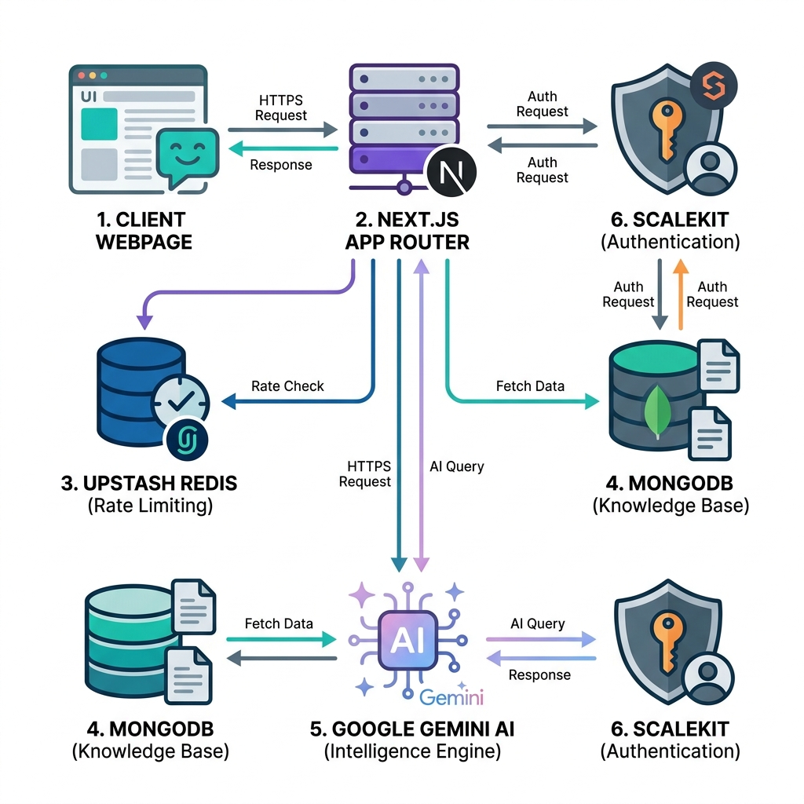
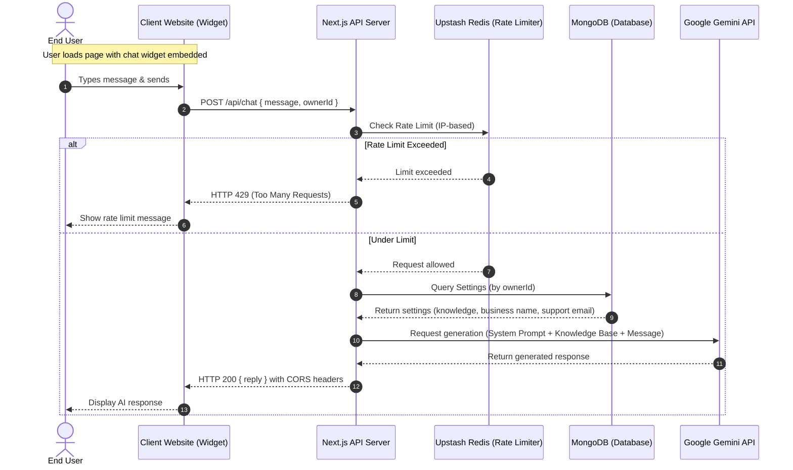
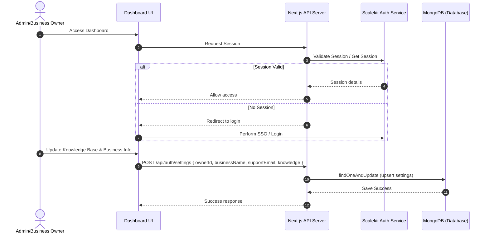
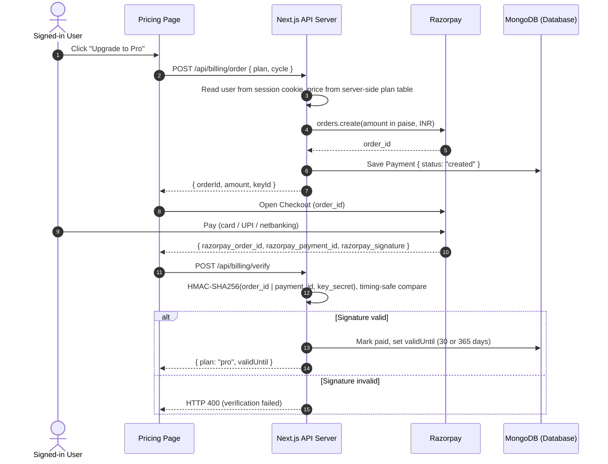

# Support.ai - AI Customer Support Chatbot

An embeddable AI customer support chatbot built with Next.js, Google Gemini, Scalekit, and Razorpay.
Businesses train the bot on their own knowledge base, then drop a single `<script>` tag on their site.

**Live demo:** [ally-support.vercel.app](https://ally-support.vercel.app) · **Source:** [github.com/ankit-gupta-git/ally-support](https://github.com/ankit-gupta-git/ally-support)

## Features

-   **Embeddable**: Add the chatbot to any website with one `<script>` tag.
-   **AI-Powered**: Uses Google's Gemini 2.5 Flash, grounded only in each business's own knowledge base.
-   **Customizable**: Train the bot with your business name, support email, FAQs, and policies.
-   **Dashboard**: Manage business details and the knowledge base, with a live "bot readiness" panel.
-   **Authentication**: Secure login via Scalekit; the dashboard is protected by middleware.
-   **Billing**: Upgrade to Pro through Razorpay Checkout, with server-side order creation and HMAC signature verification.
-   **Rate Limiting**: Every API route is rate limited per IP with Upstash Redis (stricter limits on auth and chat).
-   **Motion-rich UI**: Editorial design system with GSAP scroll animations, split-text reveals, and Lenis smooth scrolling.

## Tech Stack

-   **Framework**: Next.js 16 (App Router, Turbopack), React 19
-   **Language**: TypeScript
-   **AI Model**: Google Gemini 2.5 Flash (`@google/genai`)
-   **Auth**: Scalekit SDK
-   **Payments**: Razorpay (Orders API + Standard Checkout)
-   **Database**: MongoDB (via Mongoose)
-   **Rate Limiting**: Upstash Redis
-   **Styling**: Tailwind CSS v4
-   **Animation**: GSAP (ScrollTrigger, SplitText) + Lenis smooth scroll
-   **Icons**: Lucide React
-   **Hosting**: Vercel

## Architecture & Workflow

Support.ai utilizes a clean, modern decoupled architecture to support fast real-time chat interactions while maintaining secure dashboard administrative operations.

### System Architecture Diagram



### Core Workflows

#### 1. End-User Chat Bot Widget Flow
The embedded script handles UI rendering in the client's browser, rate-limiting is checked on the server using Upstash Redis, and responses are generated via the Google Gemini 2.5 Flash model grounded with customer-specific business settings from MongoDB.



#### 2. Administrative Dashboard Management Flow
Business owners manage their chatbot details and knowledge base training through a secure panel guarded by Scalekit SSO authentication.



#### 3. Billing Flow (Razorpay)
The browser never decides the price or the outcome. The server creates the order from its own price table, and a plan is only activated after the server verifies Razorpay's HMAC-SHA256 signature.



### API Routes

| Route | Method | Purpose |
| --- | --- | --- |
| `/api/auth/login` | GET | Redirects to Scalekit login |
| `/api/auth/callback` | GET | Exchanges the auth code and sets the session cookie |
| `/api/auth/logout` | GET | Clears the session cookie |
| `/api/auth/settings` | POST | Saves business details and knowledge base |
| `/api/auth/settings/get` | POST | Loads saved settings |
| `/api/chat` | POST | Answers a widget message with Gemini |
| `/api/billing/order` | POST | Creates a Razorpay order (signed-in users) |
| `/api/billing/verify` | POST | Verifies the payment signature and activates the plan |
| `/api/billing/status` | GET | Returns the current plan |

Rate limits (per IP, per route): 3 requests/minute on `/api/auth/*` and `/api/chat`, 10 requests/10 seconds on everything else.

### Project Structure

```
src/
├── app/
│   ├── api/            # auth, chat, and billing route handlers
│   ├── dashboard/      # protected settings page
│   ├── embed/          # embed code + live widget preview
│   └── pricing/        # pricing page
├── components/
│   ├── home/           # landing page sections (hero, process, features, ...)
│   └── ui/motion.tsx   # shared GSAP primitives (split reveals, magnetic buttons, ...)
├── lib/                # db, session, rate limiting, Razorpay, plan pricing
├── model/              # Mongoose models (Settings, Payment)
└── proxy.ts            # middleware: dashboard auth + API rate limiting
public/chatBot.js       # the embeddable widget script
```

## Setup & Local Development

1.  **Clone the repository**:
    ```bash
    git clone https://github.com/ankit-gupta-git/ally-support.git
    cd ally-support
    ```

2.  **Install dependencies**:
    ```bash
    npm install
    ```

3.  **Environment Variables**:
    Create a `.env.local` file in the root directory and add the following:
    ```env
    # Scalekit (Auth)
    SCALEKIT_ENVIRONMENT_URL=your_scalekit_url
    SCALEKIT_CLIENT_ID=your_client_id
    SCALEKIT_CLIENT_SECRET=your_client_secret

    # MongoDB
    MONGODB_URL=your_mongodb_connection_string

    # Google Gemini
    GEMINI_API_KEY=your_gemini_api_key

    # Upstash Redis (Rate Limiting)
    UPSTASH_REDIS_REST_URL=your_upstash_rest_url
    UPSTASH_REDIS_REST_TOKEN=your_upstash_rest_token

    # Razorpay (Billing) - server-side only, never prefix with NEXT_PUBLIC_
    RAZORPAY_KEY_ID=rzp_test_xxxxxxxxxxxx
    RAZORPAY_KEY_SECRET=your_razorpay_key_secret

    # App URLs
    NEXT_PUBLIC_APP_URL=http://localhost:3000
    NEXT_PUBLIC_BASE_URL=http://localhost:3000
    ```

4.  **Configure external services**:
    *   **Scalekit**: add `http://localhost:3000/api/auth/callback` to the allowed callback URLs.
    *   **MongoDB Atlas**: add your IP (or `0.0.0.0/0`) under Network Access.
    *   **Razorpay**: use Test Mode keys from Account & Settings → API Keys.

5.  **Run the development server**:
    ```bash
    npm run dev
    ```
    Open [http://localhost:3000](http://localhost:3000) with your browser.

### Testing Payments

Payments run in Razorpay **Test Mode**, so no real money is charged. In the checkout window use:

*   **UPI**: `success@razorpay` (succeeds) or `failure@razorpay` (fails)
*   **Netbanking**: choose success or failure on the test bank page
*   **Cards**: any test card from Razorpay's [test card list](https://razorpay.com/docs/payments/payments/test-card-details/)

## Deployment on Vercel

1.  Push your code to a GitHub repository.
2.  Import the project into Vercel.
3.  **Crucial Step**: Add the Environment Variables in Vercel settings.
    *   **NEXT_PUBLIC_APP_URL**: Set to your deployed URL (e.g., `https://ally-support.vercel.app`) - **No trailing slash**.
    *   **NEXT_PUBLIC_BASE_URL**: Set to your deployed URL (e.g., `https://ally-support.vercel.app`) - **No trailing slash**.
    *   Add all other secret keys (`MONGODB_URL`, `GEMINI_API_KEY`, `SCALEKIT_...`, `UPSTASH_...`, `RAZORPAY_...`).
4.  In Scalekit, add `https://<your-domain>/api/auth/callback` to the allowed callback URLs.
5.  In MongoDB Atlas, allow `0.0.0.0/0` (Vercel functions don't have fixed IPs).
6.  Deploy!

> Environment variable changes only apply to new builds. Also note that "Redeploy" on an old deployment rebuilds that old commit. To ship new code, deploy the latest commit.

## Troubleshooting

| Symptom | Cause | Fix |
| --- | --- | --- |
| Every `/api/*` call returns 500 `fetch failed` | Upstash database deleted or env vars wrong | Recreate the Redis database and update `UPSTASH_REDIS_REST_*` |
| `querySrv EBADRESP` / `ENOTFOUND` locally | Node's SRV DNS lookup fails on some networks | Use Atlas's standard `mongodb://host1,host2,host3/?ssl=true&replicaSet=...` connection string |
| "Could not connect to any servers" | IP not on the Atlas access list | Add your IP or `0.0.0.0/0` in Network Access |
| "The requested redirect_uri is missing" on sign in | Callback URL not registered in Scalekit | Add `<NEXT_PUBLIC_APP_URL>/api/auth/callback` exactly |
| Dashboard still failing after fixing the database | The failed connection is cached in the running server | Restart `npm run dev` |

## How to Embed the Chatbot

1.  Go to your deployed Dashboard.
2.  Click on "Embed Chatbot".
3.  Copy the script tag.
4.  Paste it before the closing `</body>` tag of your website's HTML.

```html
<script 
    src="https://ally-support.vercel.app/chatBot.js" 
    data-owner-id="your_unique_owner_id">
</script>
```
